# Silakka54 wireless – ZMK config

ZMK firmware config for my [Silakka54](https://github.com/Squalius-cephalus/silakka54) split keyboard: 54 keys, a Corne-style layout with a number row and 3 thumb keys per side. It runs on nice!nano v2 controllers with nice!view displays.

The keyboard is built as the `lily58` shield, so the keymap lives in [`config/lily58.keymap`](config/lily58.keymap).

## Keymap

This drawing is redrawn automatically by [keymap-drawer](https://github.com/caksoylar/keymap-drawer) every time the keymap changes. Keys with two legends are tap/hold: the big legend is the tap and the small one is the hold.

| Layer | How to get there |
| --- | --- |
| **Base** | Default. Home row mods on A S D F / J K L ; (GUI, Ctrl, Alt, Shift). |
| **HRM-off** | Press F + J together to toggle home row mods off and on, or hold Tab for HRM-off while held. |
| **Symbols** | Hold Esc or ' (quote). |
| **Numpad** | Hold G (right hand). |
| **Nav** | Hold H (left hand). |
| **Control** | Hold the Delete thumb key: Bluetooth, media, brightness, Caps Lock. |

## Printable cheatsheets

Print these at 100% (actual size). They're redrawn automatically whenever the keymap changes.

- [**Landscape (A4)**](cheatsheet/silakka54-cheatsheet.pdf): Symbols, Nav and Numpad
- [**Portrait (A4)**](cheatsheet/silakka54-cheatsheet-portrait.pdf): Base, Symbols, Nav and Numpad
- One image per layer: [Base](cheatsheet/layers/1-base.png) · [HRM off](cheatsheet/layers/2-hrm-off.png) · [Symbols](cheatsheet/layers/3-symbols.png) · [Numpad](cheatsheet/layers/4-numpad.png) · [Nav](cheatsheet/layers/5-nav.png) · [Control](cheatsheet/layers/6-control.png)

## Getting the firmware

Every push builds new firmware with GitHub Actions.

1. Open the **Actions** tab and select the latest **Build** run.
2. Download the `firmware` file at the bottom of the run summary and unzip it.
3. Flash each half: plug it in by USB, double-tap the reset button so it appears as a drive, then copy across that half's `.uf2` file (`lily58_left…` or `lily58_right…`).

## Changing the keymap

Edit [`config/lily58.keymap`](config/lily58.keymap), on GitHub with the pencil button or locally, and commit. Two workflows then run:

- **Build** ([`build.yml`](.github/workflows/build.yml)) makes the firmware.
- **Draw keymap and cheatsheets** ([`draw-keymaps.yml`](.github/workflows/draw-keymaps.yml)) redraws the picture above and the printable cheatsheets, and commits them.

Keymap reference: [ZMK docs](https://zmk.dev/docs).

ZMK is pinned to `v0.3` in [`config/west.yml`](config/west.yml), so upstream changes don't arrive until the version there is changed.

### Drawing setup

- [`keymap_drawer.config.yaml`](keymap_drawer.config.yaml): legends and styling for the drawing.
- [`keymap-drawer/silakka54_layout.json`](keymap-drawer/silakka54_layout.json): the silakka54's physical layout in the lily58 shield's key order. The lily58 has 4 key positions the silakka54 doesn't, and the config hides them. The cheatsheets use this file too.
- [`cheatsheet/render.py`](cheatsheet/render.py): draws the printable cheatsheets. Layer titles, the help text and which layers go on the one-page sheets are set at the top of the file. Which key you hold for each layer is read from the keymap.
